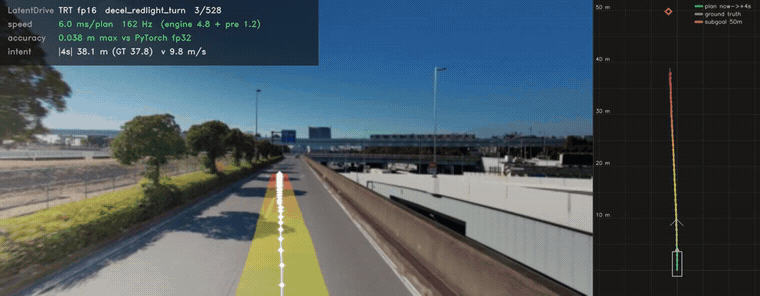

# autoware_latent_drive

TensorRT C++ inference for **LatentDrive**, a camera-only end-to-end planner: the last 2 s of front-camera
video, six points along the route and the ego motion in, a 4 s ego trajectory out, at 10 Hz. A library with
no ROS dependency, an offline sample and a ROS 2 node that replays a rosbag and draws the plan on the front
camera.

<p align="center">
  
</p>

<p align="center">
  
</p>

Open-loop replays of recorded drives with the three-camera model, every 10 Hz frame shown at 2x (the full
video is on [Hugging Face](https://huggingface.co/AutowareFoundation/latent_drive)). The ribbon is the plan,
green (now) to red (+4 s); it is drawn, not executed.

## Models

The models are on Hugging Face: [`AutowareFoundation/latent_drive`](https://huggingface.co/AutowareFoundation/latent_drive).

| Model | Cameras | File |
| --- | --- | --- |
| Three cameras | front, front-left, front-right | `camfront3-rptw-lane2-e1.onnx` |
| One camera | front | `camfront-rptw-lane2-e1.onnx` |

TensorRT engines are built locally, on the GPU that runs them (below).

## Quick start

Needs an NVIDIA GPU, Docker and the
[NVIDIA Container Toolkit](https://docs.nvidia.com/datacenter/cloud-native/container-toolkit/latest/install-guide.html).
Everything runs in the public Autoware development image (ROS 2 humble, CUDA 12, TensorRT 10.8).

```bash
git clone https://github.com/autowarefoundation/autoware_latent_drive.git
cd autoware_latent_drive
pip install -U huggingface_hub
hf download AutowareFoundation/latent_drive --revision v1.0 --local-dir models/onnx/latent_drive \
  --exclude "media/*" --exclude replay.mp4

# a shell in the container, this repository at /workspace and a rosbag at /bag
xhost +local:docker                                          # for the replay window
IMAGE=ghcr.io/autowarefoundation/autoware:universe-devel-cuda BAG=/path/to/rosbag ./docker/run.sh
```

In the container, build the library, the ROS 2 node and the engines (`models/engine/<name>-mixed.engine`):

```bash
scripts/build.sh                                                        # three cameras, ~7 min
scripts/build.sh models/onnx/latent_drive/camfront-rptw-lane2-e1.onnx   # one camera, ~1.5 min
```

## Run

Both samples need a rosbag recorded on a LatentDrive run: the cameras (`camera0`, `camera3`, `camera4`),
`/localization/kinematic_state`, `/localization/acceleration`, `/tf_static`, the front `camera_info` and the
route points the vehicle fed its model (`/tensorrt_e2e/debug/latentdrive/route_points`).

**Rosbag replay** ([`samples/rosbag`](samples/rosbag)): play the bag, plan on every front frame and draw the plan
on the front camera, in a window and an mp4.

```bash
samples/rosbag/prepare_bag.sh /bag bags/my_bag            # once per bag: a playable copy (symlinks + metadata.yaml)
samples/rosbag/run_replay.sh bags/my_bag models/engine/camfront3-rptw-lane2-e1-mixed.engine \
  start_offset:=60 out_video:=bags/my_bag/replay.mp4
```

Add `show_window:=false` without a display. On a laptop GPU, `rate:=0.5` keeps every plan.

**Offline clip** ([`samples/sample_data`](samples/sample_data)): cut a clip out of the bag on the host, then plan
on it through the library API alone, no ROS.

```bash
# on the host (needs uv)
uv run --with mcap --with mcap-ros2-support --with numpy --with opencv-python-headless \
  python3 samples/sample_data/export_clip.py /path/to/rosbag clips/my_clip --start 60 --duration 30
# in the container
build/bin/latentdrive-sample-clip --engine_file=models/engine/camfront3-rptw-lane2-e1-mixed.engine \
  --clip_dir=clips/my_clip --out_video=clips/my_clip/replay.mp4
```

## Model contract

| Tensor | Shape | Content |
| --- | --- | --- |
| `video` | `[1, 3, 3, 4, 256, 512]` (three cameras) or `[1, 3, 4, 256, 512]` (one) | 4 frames per view, 0.5 s apart, oldest first; centre-cropped to 2:1, resized, ImageNet-normalized. Views: front, front-left, front-right |
| `status` | `[1, 16]` | route points 5, 10, 15, 20, 30, 50 m ahead (x/10, y/10, ego frame), then v_fwd, v_left, a_fwd, a_left |
| `plan` | `[1, 40, 3]` | x forward, y left [m], heading [rad] in the ego frame, 0.1 s … 4.0 s |

The view count, the route point count and the waypoint count are read from the engine, so one binary serves
every checkpoint.

## More

- [`docs/details.md`](docs/details.md): native build, the `latentdrive-trt` binary, the input contract in
  detail, the status builder, the library API and the code layout
- [`samples/rosbag`](samples/rosbag), [`samples/sample_data`](samples/sample_data),
  [`ros2/latentdrive_ros`](ros2/latentdrive_ros): the samples and the ROS 2 node
- [Hugging Face model card](https://huggingface.co/AutowareFoundation/latent_drive): training, limitations

This is a research model: it is not a certified driving system and must not control a vehicle on public roads.
